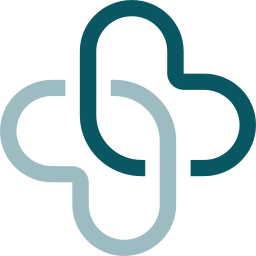
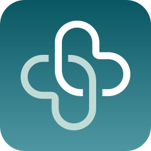

# Brand

Vector-first brand kits for **helpwave** and **App zum Doc**.

| Format | Layout | Rule |
|--------|--------|------|
| **Logo SVG** | `<kit>/logo/svg/` | Quadratic cutout — viewBox width equals height |
| **Logo PNG** | `<kit>/logo/png/<size>/` | Square canvas. `size` is the edge |
| **Logo ICO** | `<kit>/logo/ico/<size>/` | One square ICO per size (`16`–`1024`) |
| **Banner SVG** | `<kit>/banner/svg/` | Wide or tall cutout |
| **Banner PNG** | `<kit>/banner/png/<size>/` | Natural aspect. `size` is the **shorter** side |

```bash
./scripts/check-brand-svgs.sh
./scripts/export-brand-assets.sh
./scripts/export-brand-assets.sh helpwave-tasks
```

`export-brand-assets.sh` walks every `brand/<kit>/logo/svg` and `brand/<kit>/banner/svg`. Pass one or more kit names to export only those. Agent instructions: [`../AGENTS.md`](../AGENTS.md).

Prefer `rsvg-convert` (librsvg) plus ImageMagick so local exports match GitHub Actions. Actions uses Ubuntu apt packages (`librsvg2-bin`, `imagemagick` → `convert`). Locally, either `magick` (ImageMagick 7) or `convert` works; for byte-identical commits, regenerate with the same Ubuntu stack Actions uses. Override sizes with:

```bash
SIZES="32 128 1024" ./scripts/export-brand-assets.sh
PNG_SIZES="1024" ICO_SIZES="16 32 48" ./scripts/export-brand-assets.sh
```

`SIZES` sets both ladders. `PNG_SIZES` and `ICO_SIZES` override it. An ICO size that is not in `PNG_SIZES` is still rendered for that icon file.

## PNG sizes

| Size | Common use |
|------|------------|
| 16, 32, 48 | Favicons, browser UI |
| 64, 128 | Toolbars, small tiles |
| 180 | Apple touch icon |
| 192, 512 | Android / PWA icons |
| 256 | Windows tiles, denser favicons |
| 1024 | Default high-res download |

For banners, `1024` means the shorter edge is 1024px. The other edge follows the SVG aspect.

## helpwave logo variants

| Variant | File stem | Use |
|---------|-----------|-----|
| Transparent | `logo` | Over light / photo backgrounds |
| Transparent white | `logo-white` | Over dark / photo backgrounds |
| On white | `logo-on-white` | Opaque white plate |
| White on black | `logo-white-on-black` | Opaque black plate |

The same background suffixes apply to `banner` and `banner-horizontal`.

Example: [`helpwave/logo/svg/logo.svg`](helpwave/logo/svg/logo.svg) · [`helpwave/logo/png/1024/circle.png`](helpwave/logo/png/1024/circle.png) · [`helpwave/logo/ico/1024/circle.ico`](helpwave/logo/ico/1024/circle.ico)

## Trademark & license

Repository source code and documentation are under the [Mozilla Public License 2.0](../LICENSE).

**The MPL does not grant rights to trademarks.** The helpwave name, wave mark, App zum Doc name and marks, and related logos remain trademarks of helpwave GmbH. You may use these assets to refer to helpwave products accurately (for example in press coverage or integrations). Do not imply endorsement, alter the marks in misleading ways, or use them as your own brand without written permission. Contact [contact@helpwave.de](mailto:contact@helpwave.de) for brand questions.

## Colors

### helpwave

| Token | Value | Use |
|-------|-------|-----|
| Ink | `#000000` | Default mark & wordmark on light backgrounds |
| Paper | `#FFFFFF` | Inverse mark on dark backgrounds |

### App zum Doc

| Token | Value | Use |
|-------|-------|-----|
| Teal | `#095763` | Primary fill |
| Mist | `#9DBCC1` | Secondary fill |
| Soft | `#C0DBD6` | Icon highlight / on-dark secondary |
| Gradient | `#095763` → `#4E97A2` | App icon background |

## helpwave gallery

| Asset | SVG | PNG (1024) | ICO |
|-------|-----|------------|-----|
| Logo | [`logo/svg/logo.svg`](helpwave/logo/svg/logo.svg) | export after the cutout check passes | [`logo/ico/1024/logo.ico`](helpwave/logo/ico/1024/logo.ico) |
| Circle | [`logo/svg/circle.svg`](helpwave/logo/svg/circle.svg) | [`logo/png/1024/circle.png`](helpwave/logo/png/1024/circle.png) | [`logo/ico/1024/circle.ico`](helpwave/logo/ico/1024/circle.ico) |
| Banner | [`banner/svg/banner.svg`](helpwave/banner/svg/banner.svg) | [`banner/png/1024/banner.png`](helpwave/banner/png/1024/banner.png) | — |
| Banner horizontal | [`banner/svg/banner-horizontal.svg`](helpwave/banner/svg/banner-horizontal.svg) | [`banner/png/1024/banner-horizontal.png`](helpwave/banner/png/1024/banner-horizontal.png) | — |

<p>
  
  &nbsp;
  
</p>

## App zum Doc gallery

| Asset | SVG | PNG (1024) | ICO |
|-------|-----|------------|-----|
| Logo color | [`logo/svg/logo-color.svg`](app-zum-doc/logo/svg/logo-color.svg) | [`logo/png/1024/logo-color.png`](app-zum-doc/logo/png/1024/logo-color.png) | [`logo/ico/1024/logo-color.ico`](app-zum-doc/logo/ico/1024/logo-color.ico) |
| Logo on white | [`logo/svg/logo-on-white.svg`](app-zum-doc/logo/svg/logo-on-white.svg) | [`logo/png/1024/logo-on-white.png`](app-zum-doc/logo/png/1024/logo-on-white.png) | [`logo/ico/1024/logo-on-white.ico`](app-zum-doc/logo/ico/1024/logo-on-white.ico) |
| Logo on black | [`logo/svg/logo-on-black.svg`](app-zum-doc/logo/svg/logo-on-black.svg) | [`logo/png/1024/logo-on-black.png`](app-zum-doc/logo/png/1024/logo-on-black.png) | [`logo/ico/1024/logo-on-black.ico`](app-zum-doc/logo/ico/1024/logo-on-black.ico) |
| App icon | [`logo/svg/icon.svg`](app-zum-doc/logo/svg/icon.svg) | [`logo/png/1024/icon.png`](app-zum-doc/logo/png/1024/icon.png) | [`logo/ico/1024/icon.ico`](app-zum-doc/logo/ico/1024/icon.ico) |
| Circle variants | `logo/svg/circle-*.svg` | `logo/png/1024/circle-*.png` | `logo/ico/1024/circle-*.ico` |

<p>
  
  &nbsp;
  
  &nbsp;
  
</p>

## Raw GitHub URLs

```text
https://raw.githubusercontent.com/helpwave/helpwave/main/brand/helpwave/logo/svg/logo.svg
https://raw.githubusercontent.com/helpwave/helpwave/main/brand/helpwave/banner/svg/banner.svg
https://raw.githubusercontent.com/helpwave/helpwave/main/brand/helpwave/banner/png/1024/banner.png
https://raw.githubusercontent.com/helpwave/helpwave/main/brand/helpwave/logo/ico/1024/circle.ico
```

CI uploads a downloadable **brand-kit** artifact from the export workflow on each verified run.
